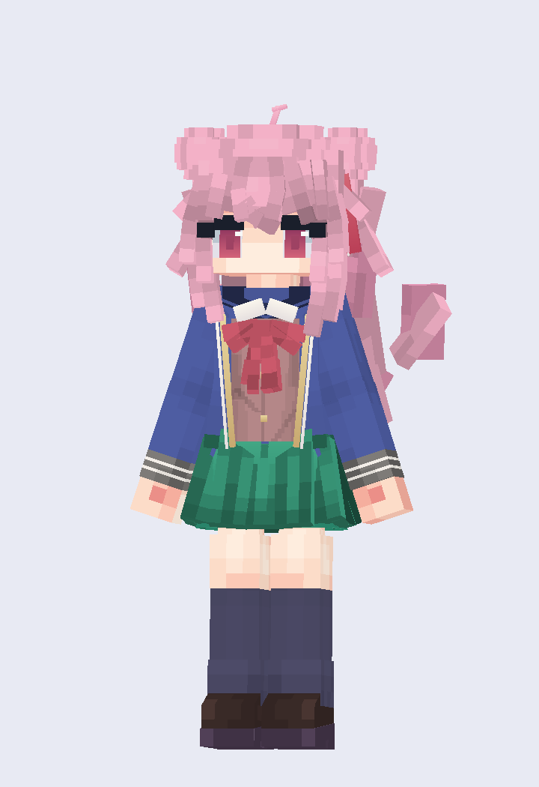
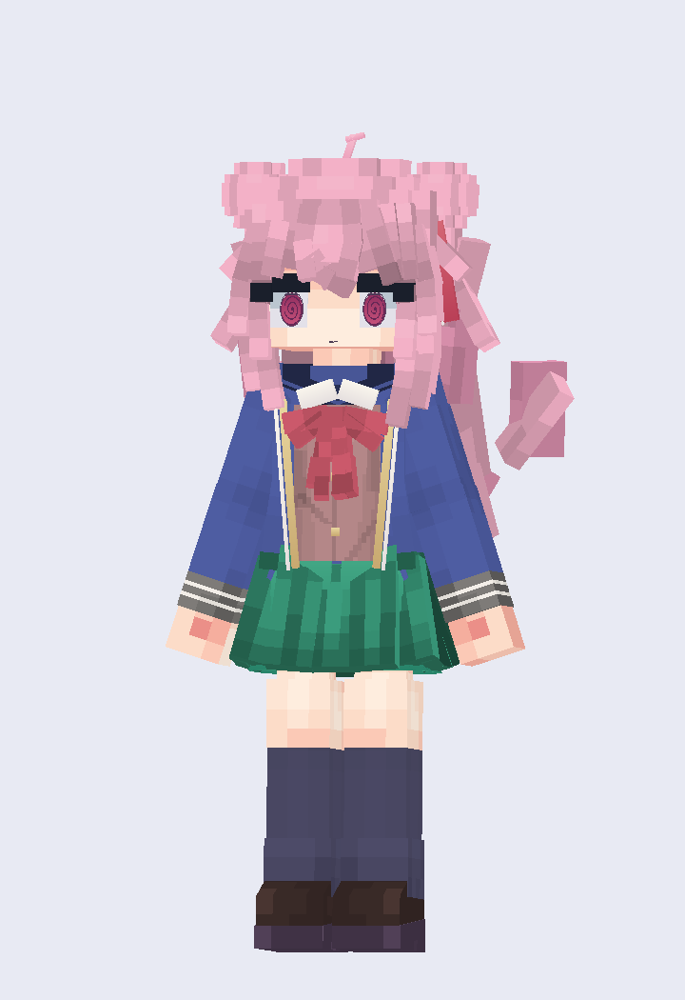

# Pink Bun · Wine Fox Base

โมเดลตัวละครสำหรับ **Yes Steve Model (YSM)** ดัดแปลงจาก **Wine Fox รุ่นชุดนักเรียน `07_jk`**: ผมชมพูมวยคู่ เสื้อคลุมสีน้ำเงิน เสื้อกั๊กน้ำตาล กระโปรงเขียว และโบแดง พร้อมสีหน้าตาแดงลายก้นหอยตอนวิ่ง

| สีหน้าปกติ | สีหน้าตอนวิ่ง |
| --- | --- |
|  |  |

ภาพด้านบนเป็นพรีวิวจากไฟล์โมเดลด้วยตัวเรนเดอร์ในโปรเจกต์ แสงและท่าทางจริงในเกมอาจต่างออกไป

## ดาวน์โหลดและติดตั้ง

1. ดาวน์โหลด [pink-bun-winefox.zip](downloads/pink-bun-winefox.zip?raw=true)
2. วาง ZIP ในโฟลเดอร์ `<เกม>/config/yes_steve_model/custom/` โดยไม่ต้องแตกไฟล์
3. ในเกมใช้ `/ysm model reload` แล้วกด **Y** บน Fabric เพื่อเลือก **Pink Bun - Wine Fox Base**

ถ้าเคยติดตั้งแบบโฟลเดอร์อยู่แล้ว ให้ใช้เพียง ZIP หรือโฟลเดอร์อย่างใดอย่างหนึ่ง เพื่อไม่ให้มีโมเดลซ้ำ

โปรเจกต์นี้พัฒนากับ **YSM 2.6.5 / Minecraft 1.20.1 Fabric** รูปแบบไฟล์และแอนิเมชันอิงต้นฉบับ Wine Fox ที่แนบใน `vendor/`

## เริ่มพัฒนา

ต้องมี **Node.js 22 ขึ้นไป** และ npm ไม่ต้องติดตั้งแพ็กเกจเพิ่ม

```sh
git clone https://github.com/PuemMTH/pink-bun-winefox.git
cd pink-bun-winefox
npm test
```

| คำสั่ง | ใช้ทำอะไร |
| --- | --- |
| `npm run build` | สร้างโมเดลใน `dist/pink_bun_winefox/` และอัปเดตภาพพรีวิวใน `docs/` |
| `npm run check` | ตรวจโมเดลที่ build แล้ว: กระโปรง สีหน้าตอนวิ่ง ขนาดมวยผม และระยะโบ |
| `npm test` | Build แล้วตรวจทั้งหมด |
| `npm run dev` | เฝ้าดูไฟล์และ build/check ใหม่เมื่อบันทึก |
| `npm run install:model` | Build และคัดลอกเข้าเกม พร้อมสำรองโมเดลเดิม |
| `npm run dev -- --install` | Build/check และติดตั้งเข้าเกมทุกครั้งที่แก้ไฟล์ |
| `npm run pack` | ตรวจทั้งหมดแล้วสร้าง ZIP ใน `downloads/` |

ตั้งค่าตำแหน่งเกมครั้งเดียว โดยคัดลอก `local.config.example.json` เป็น `local.config.json` แล้วใส่พาธโฟลเดอร์ `custom` ของคุณ ไฟล์นี้ถูกละเว้นจาก Git

```json
{
  "customDirectory": "C:/path/to/Minecraft/config/yes_steve_model/custom"
}
```

หรือส่งพาธโดยตรง:

```sh
npm run install:model -- "C:/path/to/Minecraft/config/yes_steve_model/custom"
```

หลังติดตั้งแต่ละครั้ง ใช้ `/ysm model reload` ในเกม ระบบติดตั้งจะเก็บสำเนาเดิมไว้ใน `local-backups/` ของโปรเจกต์

## แก้ตรงไหน

- **สี / ขนาดมวยผม / ระยะโบ:** `model.config.json`
- **รูปร่าง เสื้อผ้า และการประกอบโมเดล:** `src/build.cjs`
- **แสงเงาของผ้าและการจับคู่ UV:** `src/material-atlas.cjs`
- **ตาก้นหอยและการสลับสีหน้าตอนวิ่ง:** `src/run-face.cjs`
- **ต้นขาและผ้าชั้นในของกระโปรง:** `src/skirt-fix.cjs`
- **กระดูก พื้นผิว และแอนิเมชันต้นฉบับ:** `vendor/winefox-jk/`

รายละเอียดเพิ่มเติมอยู่ใน [คู่มือพัฒนา](docs/DEVELOPMENT.md) อย่าแก้ไฟล์ใน `dist/` เป็นหลัก เพราะ build ครั้งถัดไปจะสร้างทับ

## เครดิตและสิทธิ์ใช้งาน

ฐานโมเดล Wine Fox JK โดย **伊蕾娜家的咸鱼, 浅陌菌, 星屑海螺 และ 墨染逝羽** จากม็อด [Yes Steve Model](https://modrinth.com/mod/yes-steve-model) เครดิตและลิงก์ผู้สร้างเดิมเก็บไว้ใน `vendor/winefox-jk/ysm.json` และโมเดลที่ build แล้ว

โมเดลและทรัพยากรดัดแปลงเผยแพร่ตาม **CC BY-NC-SA 4.0**: ให้เครดิต ใช้แบบไม่ใช่เชิงพาณิชย์ และเผยแพร่งานดัดแปลงภายใต้สัญญาเดียวกัน ดู [LICENSE](LICENSE) และ [ATTRIBUTION.md](ATTRIBUTION.md)

รูปลักษณ์ตัวละครอิงภาพอ้างอิงที่ผู้ใช้ให้ สิทธิ์ในตัวละครต้นแบบยังเป็นของเจ้าของสิทธิ์เดิม โปรเจกต์นี้เป็นแฟนโมเดลและไม่ได้เป็นผลงานทางการของผู้สร้าง Wine Fox หรือ YSM
