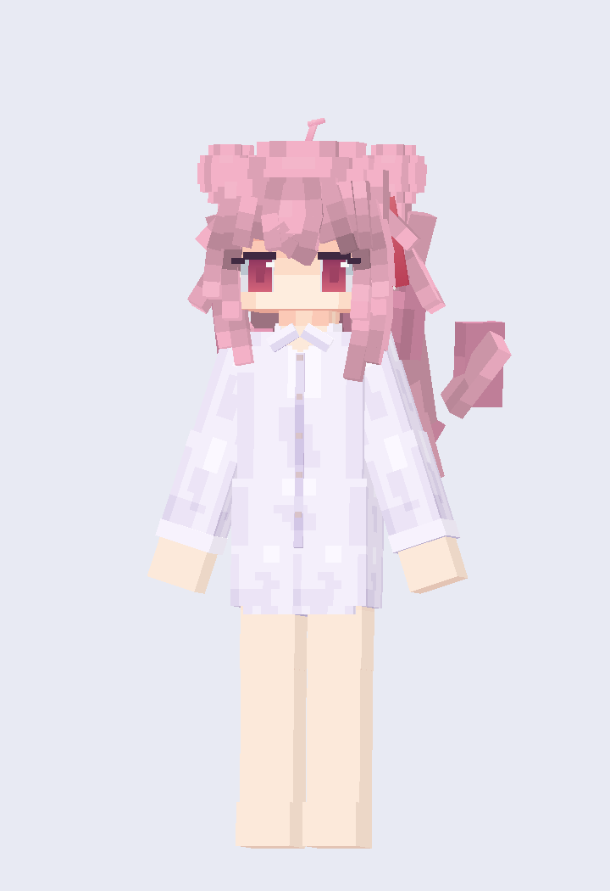

# Satou Matsuzaka

โมเดลตัวละครสำหรับ **Yes Steve Model (YSM)** ดัดแปลงจาก **Wine Fox รุ่นชุดนักเรียน `07_jk`** มีชุดนักเรียนและชุดเชิ้ตขาว ผมชมพูมวยคู่ และสีหน้าตาแดงลายก้นหอยตอนวิ่ง

| ชุดนักเรียน | สีหน้าตอนวิ่ง | เชิ้ตขาว |
| --- | --- | --- |
|  |  |  |

ภาพด้านบนเป็นพรีวิวจากไฟล์โมเดลด้วยตัวเรนเดอร์ในโปรเจกต์ แสงและท่าทางจริงในเกมอาจต่างออกไป

## Download and install

1. Download [Satou Matsuzaka · School Uniform · Square Eyes](downloads/pink-bun-winefox-square-eyes.zip?raw=true), [Satou Matsuzaka · White Shirt · Square Eyes](downloads/pink-bun-winefox-white-square-eyes.zip?raw=true), or [Satou's Aunt](downloads/satou-aunt.zip?raw=true).
2. Put the ZIP in `<game>/config/yes_steve_model/custom/`. If you already installed that model as a folder, keep one copy.
3. Run `/ysm model reload` in Minecraft. Press **Y** on Fabric and select the model by name and outfit.

Press **Z** to open the animation wheel. Both Satou outfits have eight facial expressions and six photo poses. The Square Eyes iris highlights and sprint spirals use YSM's `ysmGlow` bones.

The models target **YSM 2.6.5 on Minecraft 1.20.1 Fabric**. The previous [school uniform](downloads/pink-bun-winefox.zip?raw=true) and [white shirt](downloads/pink-bun-winefox-white.zip?raw=true) packs are available for comparison.

### Satou's Aunt

Satou's Aunt uses the **Matured Wine Fox** rig from `vendor/winefox-matured/`. The ZIP includes attribution and the license.

To compare flight poses across the three models, run `npm run export:viewer -- --flight-review <baseline-directory>`. The baseline directory should contain the three original YSM model folders. The review is written to `dist/viewer/flight-review/`.

Use `npm run pack:aunt` to build and pack Aunt on her own. Edit `src/aunt-head.cjs` or `src/aunt-outfit.cjs` for her appearance. Run `npm run export:viewer -- --aunt-review` for turnarounds and frames of her walking, running, and jumping.

Edit `src/aunt-flight.cjs` to change Elytra or Creative flight for Satou’s Aunt. Run `node scripts/export-viewer.cjs --aunt-flight-review <previous-model-folder>` to render the original and alternate poses for comparison.

## เริ่มพัฒนา

### JavaScript rendering core

มี ES module แยกจาก UI สำหรับเรนเดอร์ใน browser บน static hosting/GitHub Pages: `loadModel()`, `createRenderer()`, `render()`, `toBlob()` และการโหลดโฟลเดอร์จากเครื่อง ใช้ `node renderer/javascript/build.cjs` เพื่อสร้าง package พร้อม core/Three.js ใน `dist/javascript/` ดู [JavaScript API](renderer/javascript/README.md)

### Python rendering core

แยกตัวเรนเดอร์เป็น Python package ที่ import โมเดลแล้วสร้างภาพด้วยพารามิเตอร์ได้ ไม่ต้องเปิดเว็บหรือเกม รองรับโฟลเดอร์/ZIP ของ YSM, ท่าและคีย์เฟรมจริง, มุมกล้อง, ฉากโปร่งใส และการปรับกระดูก อ่าน [API และตัวอย่าง](renderer/python/README.md)

```sh
python -m pip install ./renderer/python
python -m ysm_render dist/pink_bun_winefox --animation run --time 0.2 --yaw 25 --out renders/run.png
```

### เว็บพรีวิว 3D

หมวด **โพสถ่ายรูป** มี 6 โพสสำหรับจัดมุมและบันทึกภาพ: ทักทาย มือแนบแก้ม เท้าเอว ประสานมือ มือแนบอก และกางแขน เลือกแล้วตัวละครจะค้างท่าไว้ หรือเปิดตารางดูทุกโพสพร้อมกันได้

```sh
npm run viewer
```

เปิด URL ที่คำสั่งแสดงเพื่อหมุนดูโมเดล เปลี่ยนท่า ย้อนดูคีย์เฟรม สลับสีหน้า และบันทึก PNG อ่าน [คู่มือเว็บพรีวิว](viewer/README.md) สำหรับรายละเอียดการเรนเดอร์และข้อจำกัดเมื่อเทียบกับเกม

เพิ่มได้หลายตัวละครในฉากเดียว เลือกโฟลเดอร์รวมเพื่อเปิดหลายโมเดลพร้อมกัน และแบ่ง **1 / 2 / 4 Views** ได้ แต่ละช่องเลือกตัวละครและมุมกล้องแยกกัน ส่วนท่า ความเร็ว และการหยุดเล่นปรับแยกรายตัวได้จากรายการด้านขวา

ใช้ `npm run build:viewer` เพื่อส่งออกเว็บพร้อมโมเดลไปยัง `dist/viewer/` สำหรับ static hosting และ `npm run check:viewer` เพื่อตรวจตัวอ่านโมเดล/แอนิเมชัน GitHub Actions แนบเว็บที่ build แล้วเป็น artifact ชื่อ `pink-bun-model-studio`

ใช้ `npm run export:viewer` เพื่อสร้างภาพจากโมเดลและแอนิเมชันที่ build แล้วด้วย Model Studio เปิด `index.html` ของผลลัพธ์ใน `dist/ysm-render-checks/` เพื่อเทียบภาพทุกเคสกับชีตอ้างอิง ดูการตั้งค่าและข้อกำหนดใน [คู่มือเว็บพรีวิว](viewer/README.md)

ใช้ `npm run export:viewer -- --eye-review` เพื่อเรนเดอร์ภาพเทียบรุ่นเดิมกับ Square Eyes ทั้งสองชุด ในสีหน้าและเฟรมเดียวกัน รวมตัวอย่างตาเรืองแสงในที่มืด ผลลัพธ์อยู่ใน `dist/ysm-eye-reviews/`

### Model development

Requires **Node.js 22 or later** and npm. The model build uses no npm dependencies.

```sh
git clone https://github.com/PuemMTH/pink-bun-winefox.git
cd pink-bun-winefox
npm test
```

| Command | Purpose |
| --- | --- |
| `npm run build` | Build all three active models and the two earlier Satou variants in `dist/`. |
| `npm run check` | Validate generated geometry, texture and animation resources, and flight clips. |
| `npm test` | Build and check the models. |
| `npm run dev` | Rebuild and check models when you save a source change. |
| `npm run install:model` | Build and install both Square Eyes outfits and Aunt, backing up any existing copies. |
| `npm run dev -- --install` | Rebuild, check, and install all three active models when you save a source change. |
| `npm run pack` | Build, check, and write the model ZIPs in `downloads/`. |

Copy `local.config.example.json` to `local.config.json`, then set the path to your game's `custom` folder. Git ignores the local config.

```json
{
  "customDirectory": "C:/path/to/Minecraft/config/yes_steve_model/custom"
}
```

You can also pass the folder path directly.

```sh
npm run install:model -- "C:/path/to/Minecraft/config/yes_steve_model/custom"
```

After installing, run `/ysm model reload` in Minecraft. The installer saves previous copies in `local-backups/`.

## แก้ตรงไหน

- **ชื่อ / สี / ขนาดมวยผม / ระยะโบ:** `model.config.json`
- **รูปร่าง เสื้อผ้า และการประกอบโมเดล:** `src/build.cjs`
- **แสงเงาของผ้าและการจับคู่ UV:** `src/material-atlas.cjs`
- **ตาก้นหอยและการสลับสีหน้าตอนวิ่ง:** `src/run-face.cjs`
- **ตาเหลี่ยมและลายก้นหอยของรุ่น Square Eyes:** `src/square-eyes.cjs`
- **สีหน้าในวงล้อและชุดเชิ้ตขาว:** `src/expressions.cjs` และ `src/white-outfit.cjs`
- **ต้นขาและผ้าชั้นในของกระโปรง:** `src/skirt-fix.cjs`
- **กระดูก พื้นผิว และแอนิเมชันต้นฉบับ:** `vendor/winefox-jk/`

รายละเอียดเพิ่มเติมอยู่ใน [คู่มือพัฒนา](docs/DEVELOPMENT.md) อย่าแก้ไฟล์ใน `dist/` เป็นหลัก เพราะ build ครั้งถัดไปจะสร้างทับ

## เครดิตและสิทธิ์ใช้งาน

เครดิตและลิงก์ผู้สร้างฐานโมเดล Wine Fox JK อยู่ใน `ATTRIBUTION.md` ที่แนบในทุก ZIP ข้อมูลต้นฉบับอยู่ใน `vendor/winefox-jk/ysm.json`

โมเดลและทรัพยากรดัดแปลงเผยแพร่ตาม **CC BY-NC-SA 4.0**: ให้เครดิต ใช้แบบไม่ใช่เชิงพาณิชย์ และเผยแพร่งานดัดแปลงภายใต้สัญญาเดียวกัน ดู [LICENSE](LICENSE) และ [ATTRIBUTION.md](ATTRIBUTION.md)

รูปลักษณ์ตัวละครอิงภาพอ้างอิงที่ผู้ใช้ให้ สิทธิ์ในตัวละครต้นแบบยังเป็นของเจ้าของสิทธิ์เดิม โปรเจกต์นี้เป็นแฟนโมเดลและไม่ได้เป็นผลงานทางการของผู้สร้าง Wine Fox หรือ YSM
