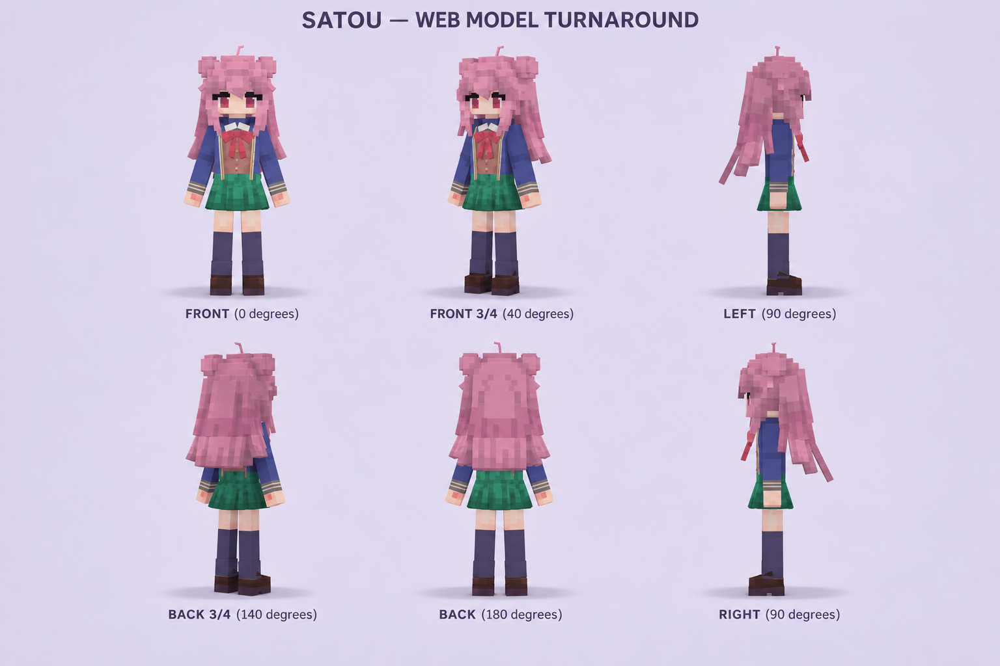
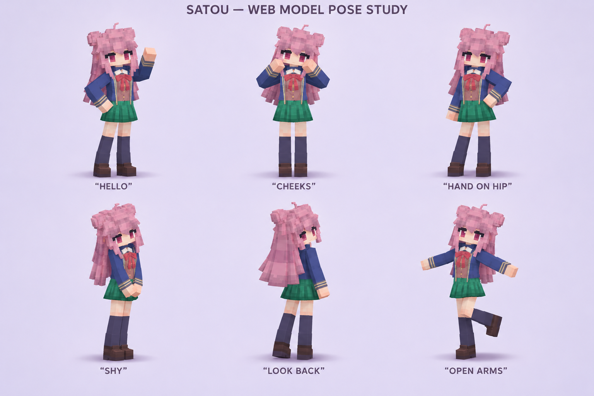

# Satou — current web model concepts

ภาพชุด v2 สร้างด้วย built-in image_gen โดยอ้างอิงภาพที่จับจาก [เว็บ Model Studio](https://pink-bun-model-viewer.deep-birch-6670.chatgpt.site/) ทั้งด้านหน้า ด้านข้าง ด้านหลัง และตารางโพส ไม่ได้ใช้ภาพพรีวิวเก่าใน docs เป็นต้นแบบ

ภาพเหล่านี้เป็นภาพคอนเซปต์จาก AI สำหรับพิจารณาจุดปรับโมเดลต่อไป ไม่ใช่การเรนเดอร์ mesh แบบวัดระยะได้

- [Turnaround — 6 มุม](turnaround-web-v2.png)
- [Pose study — 6 โพส](poses-web-v2.png)
- [พรอมป์ตและแหล่งอ้างอิง](PROMPTS-web-v2.md)

## บุคลิกและสีหน้าจากภาพอ้างอิง

ชุดเพิ่มเติมคงสไตล์พิกเซลของ poses-web-v2.png แล้วใช้ภาพอนิเมะ/มังงะที่ผู้ใช้ให้เป็นอ้างอิงบุคลิก ตาแดงก้นหอย และท่าประคองหน้า

- [โพสบุคลิกเต็มตัว 4 แบบ](personality-poses-v1.png)
- [สีหน้าระยะใกล้ 4 แบบ](personality-expressions-v1.png)
- [พรอมป์ต image_gen](PROMPTS-personality-v1.md)

## ท่าจากแอนิเมชัน YSM — 6 ท่า 18 มุม

ตรวจชื่อคลิปและช่วงคีย์เฟรมจากไฟล์โมเดลจริง แล้วสร้างภาพคอนเซปต์ด้วย built-in image_gen โดยคงบุคลิกและสไตล์พิกเซลจากชุดล่าสุด แต่ละท่ามีมุมหน้าเฉียง ข้าง และหลังเฉียง

- [ยืน / เดิน](ysm-idle-walk-v1.png)
- [วิ่ง / กระโดด](ysm-run-jump-v1.png)
- [ย่อ / นั่งพับขา](ysm-sneak-sit-v1.png)
- [รายชื่อท่า ช่วงเวลา และข้อมูลต้นทาง](YSM-ACTION-GUIDE-v1.md)
- [พรอมป์ตทั้ง 3 ชีต](PROMPTS-ysm-actions-v1.md)

## ชุดอยู่บ้าน — เชิ้ตขาวตัวหลวม

คอนเซปต์ชุดเพิ่มเติมจากภาพเสื้อเชิ้ตขาวแขนยาวที่ผู้ใช้ให้ คงตัวละครและสไตล์พิกเซลเดิม เสื้อสีขาวไล่เงาเทาอมม่วง คอปก กระดุมหน้า ปลายแขนเรียบ และชายเสื้อยาว โดยยังไม่ได้แก้ไฟล์โมเดล YSM

- [ชุดเชิ้ตขาว 6 มุม](white-shirt-turnaround-v1.png)
- [ท่ายืนและท่านั่ง 4 แบบ](white-shirt-poses-v1.png)
- [พรอมป์ต built-in image_gen](PROMPTS-white-shirt-v1.md)
