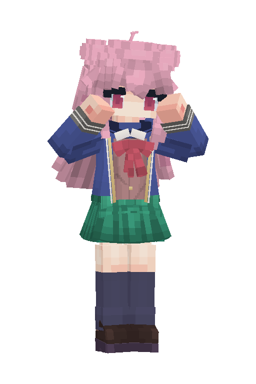

# ysm-render · Python

Standalone rendering code extracted/ported from Model Studio: load a model and render a PNG using parameters. **No browser, Node.js, Minecraft, GPU, OpenGL or display server is needed at runtime.** It uses Python 3.10+, NumPy for geometry/rasterization and Pillow for textures and PNG output.

## Install and import

From the repository root (this package is not published on PyPI):

```sh
python -m pip install ./renderer/python
```

```python
from ysm_render import load_model, render, RenderOptions

model = load_model("dist/pink_bun_winefox")  # Or downloads/pink-bun-winefox.zip

image = render(model, RenderOptions(
    animation="run", time=0.2,
    yaw=25, pitch=8,
    width=1024, height=1024,
    background=None,  # Transparent RGBA
))
image.save("running.png")

# Reuse the loaded model and supply keyword parameters directly.
render(model, animation="studio_photo_cheeks", yaw=15).save("portrait.png")
```

`render` returns a `PIL.Image.Image` in RGBA mode. `render_to_file(model, "out.png", **parameters)` creates the output directory, saves PNG with model name/author/license metadata, and returns its absolute `Path`. Loading/baking happens once per `Model`; repeated renders do not reload files. Separate renders do not retain a previous pose.

## Inputs

- YSM model directory containing `ysm.json` and its referenced JSON/PNG files.
- Model ZIP containing one `ysm.json`; for a ZIP with several models, pass `manifest="character/ysm.json"`.
- The website's exported `dist/viewer/assets/` directory (`model.json`, `texture.png`, optional `animations.json` and `info.json`).
- Bedrock geometry JSON with explicit assets:

```python
model = load_model(
    "model.json",
    texture="skin.png",
    animations=["main.animation.json", "extra.animation.json"],
    geometry_index=0,
)
```

Use `skin=1` to select another texture entry in `ysm.json`. Assets are read locally; ZIPs are read without extraction. Model manifests cannot access files outside the selected model directory/archive. `Model(geometry_dict, pillow_texture, animations_dict, info_dict)` also accepts in-memory data.

## Parameters

| Parameter | Default | Meaning |
| --- | --- | --- |
| `width`, `height` | 512, 768 | Output pixels |
| `animation` | `"auto"` | Idle if available, otherwise bind pose; `None` requests bind pose; unknown names raise an error |
| `time` | 0 | Animation time in seconds |
| `loop` | `True` | Wrap time at clip duration; `False` holds the final frame |
| `yaw`, `pitch`, `roll` | 0, 3, 0 | Camera degrees; yaw 0 = front, 90 = side, 180 = back; pitch 90 = above |
| `zoom`, `padding` | 1, 0.08 | Scale relative to automatic framing; padding is the fraction reserved on each edge |
| `background` | `None` | Transparent; or a color name, hex string, RGB/RGBA tuple |
| `shading` | `"lit"` | Simple directional lighting; `"unlit"` preserves texture colors |
| `ambient`, `light_direction` | 0.7, (-3, 6, -5) | Ambient fraction and direction toward the light in world coordinates |
| `supersample` | 1 | 1–4; 1 retains crisp pixel edges, higher values downsample with Lanczos |
| `alpha_cutoff` | 3 | Texture alpha threshold in 0–255; surviving pixels are opaque cutouts |
| `blink` | `False` | Sample the original blink layer; off by default for still pictures |
| `speed` | automatic | Molang ground speed; run = 5.6, walk = 3, otherwise 0 |
| `head_yaw`, `head_pitch` | 0, 0 | Values for the model's Molang head controls |
| `variables` | `{}` | Extra Molang context, for example `{"ysm.food_level": 4}` |
| `bone_overrides` | `{}` | Override a named bone's `rotation`, `position` or `scale` after animation sampling |

Bone overrides use **Bedrock degrees/model units**, relative to the bone's bind transform. Returned mesh coordinates use world units: reflected X and 1/16 scale, then the metadata's width/height scales (fallback 0.7), exactly as the website adapter does. Auto-framing considers the current pose; use the same pose/time when comparing camera views. The maximum working image is 16,777,216 pixels including supersampling.

```python
render(model, bone_overrides={
    "Head": {"rotation": [0, -15, 5]},
    "LeftArm": {"rotation": [-20, 0, -30]},
}).save("custom-pose.png")

# Reuse just the core geometry/animation calculations in another renderer:
mesh = model.mesh(animation="walk", time=0.5, blink=False)
vertices = mesh.vertices    # N x 3 world positions
uvs = mesh.uvs              # N x 2 normalized texture UVs (top-left origin)
triangles = mesh.triangles  # M x 3 vertex indices
matrices = model.bone_matrices(animation="walk", time=0.5)
```

Cached texture, UV and triangle-index arrays are read-only; call `.copy()` if your own backend needs to modify them.

Six static `studio_photo_*` poses are included for compatible Wine Fox rigs. Inspect `model.animations` for their names and the original clips. The source animation JSON is never modified. Preset rotations live in `ysm_render/photo_poses.json` and match the website's six presets.

## CLI and parameter files

```sh
python -m ysm_render dist/pink_bun_winefox --out renders/run.png --animation run --time 0.2 --yaw 25 --width 1024 --height 1024
ysm-render downloads/pink-bun-winefox.zip --params renderer/python/examples/parameters.json --out renders/pose.png
ysm-render dist/pink_bun_winefox --list-animations
```

Explicit CLI flags override a JSON parameter file. `--animation none` selects the bind pose. Use `--no-loop` to clamp time, or `--blink` to enable the blink layer. `examples/render_character.py` shows batch rendering several images from one loaded model.

## Algorithm and limits

1. Load the selected geometry, animation layers, texture and metadata.
2. Bake cube faces with inflate, local cube rotation, signed per-face/box UVs and mirroring.
3. Sample linear/step/Catmull-Rom keyframes and a whitelisted Molang expression subset, then compose bone matrices in Z-Y-X order.
4. Transform the mesh into world coordinates and project into an orthographic camera.
5. Rasterize triangles at pixel centers using barycentric UV/depth interpolation, nearest-neighbor texture lookup, cutout alpha and a z-buffer. Optionally shade in linear color space and downsample.

This is a port of the repository's browser adapter, not YSM's closed native renderer. It does not reproduce native stateful hair physics, animation controllers, held items, Minecraft lightmaps, cast shadows or perspective projection. Unsupported Molang/stateful expressions evaluate to zero and are never executed. Encrypted `.ysm`, Live2D, VRM, FBX and GLTF inputs are outside this loader's scope. A loaded model's geometry/animation data should not be mutated concurrently; normal independent render calls use their own image/depth/pose buffers.

## Development and verification

```sh
python -m pip install -e ./renderer/python
npm run build
python -m unittest discover -s renderer/python/tests -v
python -m pip wheel ./renderer/python --no-deps --wheel-dir dist/python
```

Tests cover signed UVs/inflate, safe expressions and keyframe endpoints, alpha holes revealing a rear surface, folder/ZIP imports, deterministic RGBA rendering and invalid paths/parameters. When Node and the repository model are present, the development-only reference test checks **all bone matrices and two vertices/UVs from each cube** against the existing Three.js adapter for idle, walk, run and a photo pose. Node is not shipped in or required by the Python package. GitHub Actions runs these checks and attaches a Python wheel.



Code follows the repository's CC BY-NC-SA 4.0 license; see `LICENSE`. The example character uses Wine Fox JK by 伊蕾娜家的咸鱼, 浅陌菌, 星屑海螺 and 墨染逝羽, with the Satou Matsuzaka adaptation by puemmth. Character assets retain their original rights/credits; they are not bundled into the wheel. See the repository's [attribution](https://github.com/PuemMTH/pink-bun-winefox/blob/master/ATTRIBUTION.md). NumPy and Pillow retain their respective licenses.
